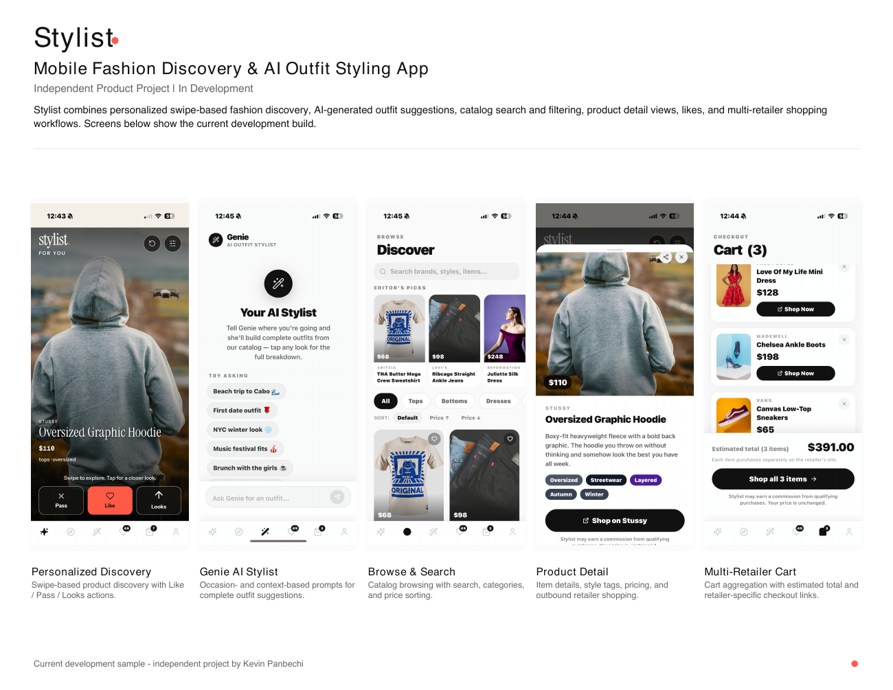

# Stylist · Frontend

An iPhone fashion-discovery app that brings swipe browsing, a personal closet, and AI outfit ideas into one experience.

**React Native · Expo · JavaScript / TypeScript · Reanimated · Jest**



*Screens from the September 2026 development work sample. Stylist is in development; these images are not a claim of an App Store release.*

## My role

I'm Kevin Panbechi, the founder and product builder behind Stylist, shaping the product concept, user experience, and feature priorities. I use AI-assisted development to turn ideas into working features, then evaluate and refine the results through testing and iteration.

## What this repository contains

A focused selection of real frontend source and tests from the larger Stylist project. Start with the swipe card, then follow the supporting accessibility and state-management code. The complete application also uses a Hono API and Supabase; this sample runs its tests independently, without an account, backend, or API key.

| Explore | What to look for |
| --- | --- |
| [SwipeCard](src/components/SwipeCard.jsx) | Gesture-driven animation, tap alternatives, and protection against duplicate or stale animation callbacks |
| [Motion tests](src/components/SwipeCard.motion.test.jsx) | Timing, cancellation, callback ordering, and Reduced Motion behavior with mocked native boundaries |
| [Reduced Motion hook](src/utils/useReducedMotionPreference.ts) | Safe initial state, subscription cleanup, and ownership when device events race the initial preference read |
| [Pagination](src/utils/browsePagination.js) | Encoded search, bounded query text, and duplicate-free page merging |
| [Product presentation](src/utils/productPresentation.js) | Currency formatting, VoiceOver labels, and share text |
| [First-ten progress](src/utils/firstTenProgress.js) | Confirmed-action tracking, duplicate suppression, Undo, and bounded retained state |
| [Closet summary](src/features/closet/closetSummary.ts) | Runtime validation and explicit loading, refreshing, stale, and unavailable states |
| [Design tokens](src/design/tokens.js) | Shared color, type, spacing, motion, and touch-target decisions |

## Run the checks

Use Node.js 22 or newer:

```bash
npm ci
npm test
npm run typecheck
```

The tests use Jest and the Expo preset. Native animation, image, and gesture boundaries are mocked where needed. They verify JavaScript behavior; they do not establish physical iPhone performance or a signed release build.

This is a source-and-test sample, not a standalone Expo application: it has no app entrypoint or production service configuration.

## Product experience

- **For You:** discover products one at a time with Pass, Like, and Looks actions.
- **Discover:** search, filter, and browse the catalog.
- **My Closet:** revisit saved items and outfit selections.
- **Genie:** ask for outfit ideas based on an occasion or context.
- **Product detail and shopping:** inspect an item and continue to the retailer.

The screenshots show the broader product. Backend recommendation logic, AI calls, authentication, private photos, checkout integrations, and account data are outside this public sample.

## Engineering decisions

**Separate animation from confirmation.** Visual movement and an accepted user action are different events. The swipe component coordinates ownership with callbacks so a late completion or refusal cannot take over a newer action.

**Treat accessibility as interaction design.** The card supports explicit actions alongside gestures. Shared labels describe product information; motion preferences default conservatively while the native setting loads.

**Preserve useful state during failures.** Closet counts distinguish missing data from a stale cached result. Pagination merges repeated products without replacing the first valid occurrence.

**Keep UI decisions consistent.** Shared tokens connect motion timing, touch targets, typography, and color instead of making each component invent its own values.

See the [architecture and reading guide](docs/architecture.md) for the wider app context and [source provenance](docs/source-manifest.sha256) for the selected files' checksums.

## Scope and attribution

The selected `src/` files were copied unchanged from the personal Stylist project on November 9, 2026. The test harness, documentation, and CI configuration were prepared for this public sample. The development overview comes from my existing Stylist work sample; third-party product imagery and brand marks belong to their respective owners and are shown as interface examples.

No company-owned code is included. Production configuration, private release history, and user data remain outside this repository. No open-source license is granted by this publication.
