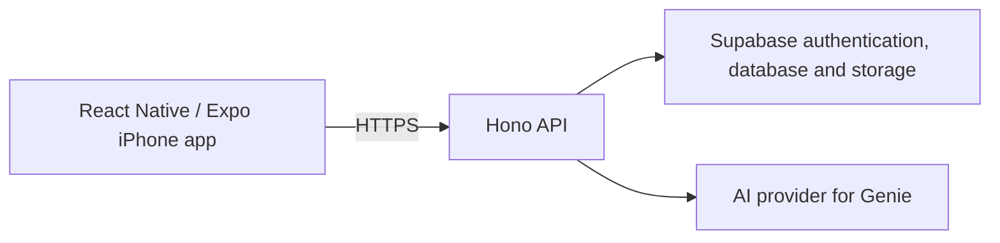

# Architecture and reading guide

Stylist's product flow starts with discovery: choose a product, save it, and revisit it in a personal collection. Genie offers a second route through outfit ideas. This public sample focuses on the frontend interaction boundaries.

## Wider application

Only selected mobile modules are included here. Provider credentials and privileged database access belong on the server. The public test harness does not contact these services.

## Start with the swipe card

Read `src/components/SwipeCard.jsx` alongside `SwipeCard.motion.test.jsx`.

The component accepts a product, its stack position, and action callbacks. React Native Gesture Handler interprets the gesture; Reanimated manages movement. JavaScript callbacks notify the parent about the action and animation lifecycle. Ownership refs and animation tokens prevent a late completion from being mistaken for the active interaction.

The test suite controls native animation callbacks explicitly. Look for the cases covering cancellation, Reduced Motion, and the order in which the parent accepts or refuses an action. These are logic tests with native boundaries mocked, rather than device gesture tests.

## Accessibility and asynchronous state

`useReducedMotionPreference.ts` starts with motion disabled while the native preference is unknown. A preference-change event takes precedence over the older asynchronous initial read. Cleanup prevents an unmounted hook from applying that result.

`productPresentation.js` provides consistent spoken product labels and price text. `InlineQueryNotice.tsx` exposes a labelled retry action and a busy state. `closetSummary.ts` distinguishes loading, unavailable, stale, refreshing, and current data, keeping last-known counts understandable to a screen-reader user.

## Bounded state

`browsePagination.js` encodes query parameters and limits search text. Its merger removes duplicate product IDs while preserving order. Request cancellation and server cursor validation are responsibilities of the wider application, not this helper.

`firstTenProgress.js` counts confirmed action IDs once and supports rearming the tenth-action milestone after Undo. After the eleventh distinct confirmation, it retires that milestone and releases retained IDs. It is a milestone tracker, not a lifetime swipe counter.

## Integration requirements

The components expect the host application to provide the React Native / Expo runtime, gesture setup, fonts named in the design tokens, and parent callbacks for persistence and navigation. Fonts and an app bootstrap are not bundled in this source sample.

The existing source is presented for review, with its focused tests. It is not a promise that all malformed inputs, device behavior, accessibility requirements, or production paths are covered.
